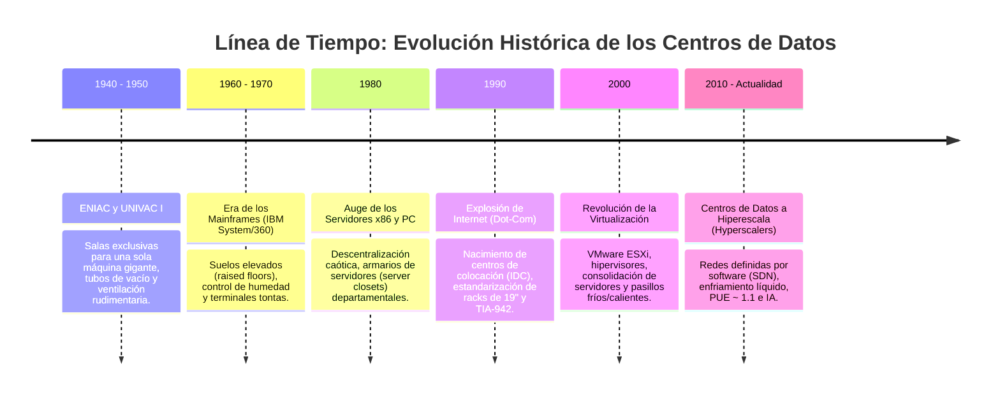
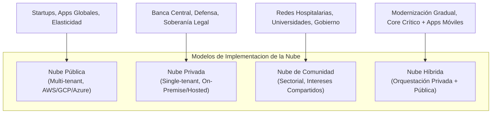
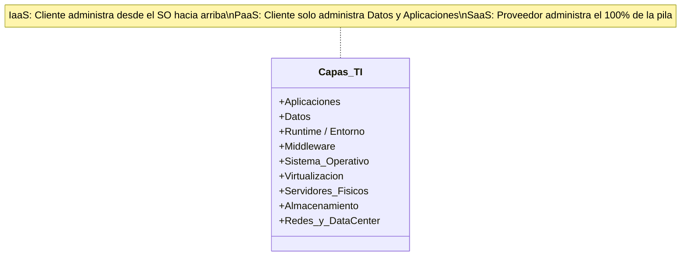
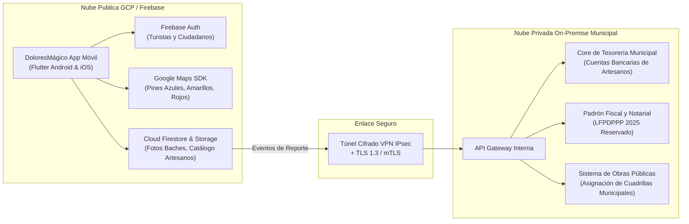
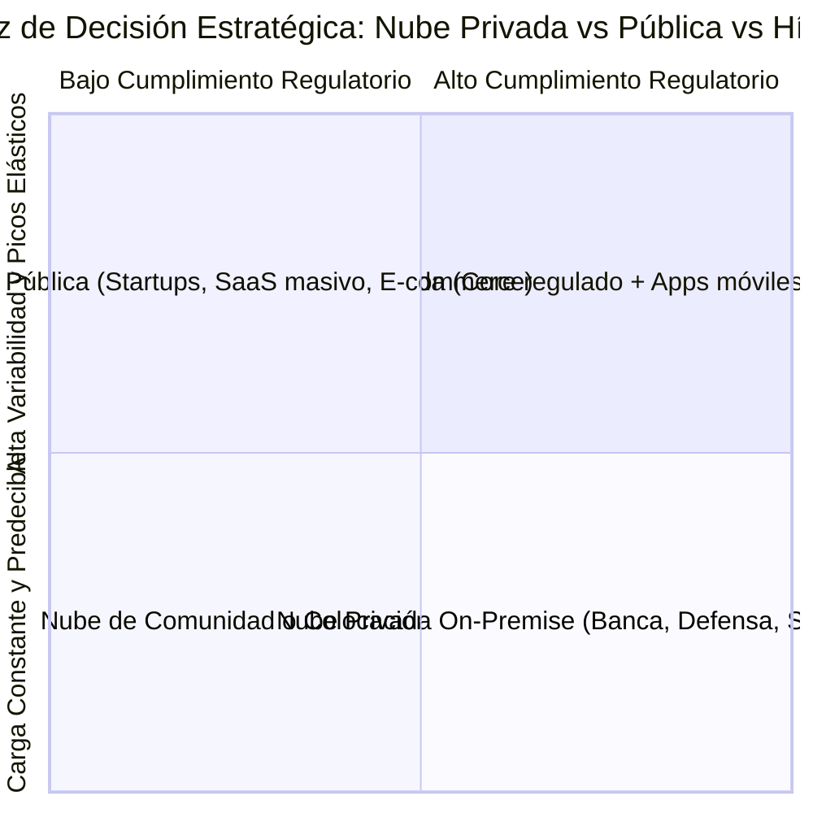

# 🏛️ Infraestructura y Evolución de los Centros de Datos, Conceptos y Modelos de la Nube, y Seguridad Móvil Integral

**Universidad Tecnológica del Norte de Guanajuato (UTNG)**  
**Materia:** Desarrollo Móvil Integral | **Docente:** Lic. José de Jesús Eduardo Barrientos Avalos  
**Proyecto:** DoloresMágico App (o DoloresConecta) — Aplicación Móvil en Flutter & Dart  
**Equipo de Trabajo:** Grupo GIDS6101-E  
- **Valeria Guadalupe Calvillo Mendoza** (Matrícula: `1223100392`) — *Product Owner & Mobile Backend Lead*  
- **María del Carmen Vargas Martínez** (Matrícula: `1220100084`) — *Scrum Master & Mobile UI/UX Flutter Lead*  
**Fecha de Publicación:** Octubre de 2026 | **Meta Inamovible del PMV:** 20 de Noviembre de 2026  

---

## 📑 Índice de Contenidos

1. [Infraestructura y Evolución de los Centros de Datos (Preguntas 1 a 3)](#1-infraestructura-y-evolución-de-los-centros-de-datos)
2. [Conceptos y Modelos de la Nube (Preguntas 4 a 6)](#2-conceptos-y-modelos-de-la-nube)
3. [Beneficios, Seguridad y Mitigación de Riesgos (Preguntas 7 a 9)](#3-beneficios-seguridad-y-mitigación-de-riesgos)
4. [Aplicación en el Sector Educativo y Clasificación Estratégica (Preguntas 10 a 15)](#4-aplicación-en-el-sector-educativo-y-clasificación-estratégica)
5. [Implementación Práctica en la Arquitectura de DoloresMágico App](#5-implementación-práctica-en-la-arquitectura-de-doloresmágico-app)
6. [Referencias Bibliográficas en Formato APA 7.ª Edición](#6-referencias-bibliográficas-en-formato-apa-7ª-edición)

---

## 1. Infraestructura y Evolución de los Centros de Datos

### Pregunta 1: ¿Qué es un centro de datos y por qué es fundamental comprender este concepto antes de definir la computación en la nube?

Un **centro de datos** (*Data Center*) es una instalación física especializada e industrializada, diseñada para concentrar, albergar, interconectar y operar de forma ininterrumpida la infraestructura crítica de tecnologías de la información (TI) y telecomunicaciones de una organización. A nivel de ingeniería civil y electromecánica, un centro de datos integra:
1. **Infraestructura de Cómputo y Almacenamiento:** Bastidores o *racks* estandarizados (EIA-310 de 19 pulgadas y Open Compute Project de 21 pulgadas) que alojan servidores blade/rack, matrices de almacenamiento de estado sólido (NVMe/SSD) y conmutadores de red (*switches*) de alta velocidad en topologías *Spine-Leaf*.
2. **Sistemas de Energía Ininterrumpida:** Cuadros eléctricos de media tensión, transformadores secos, bancos de Sistemas de Alimentación Ininterrumpida (UPS) de doble conversión en topología $N+1$ o $2N$, Unidades de Distribución de Energía (PDU) con conmutación estática (STS) y grupos electrógenos (generadores diésel) con capacidad de autonomía de varios días sin suministro de la red pública.
3. **Climatización y Control Ambiental:** Sistemas de enfriamiento de precisión (CRAC/CRAH), confinamiento de pasillos fríos y calientes (*Hot/Cold Aisle Containment*), sistemas de enfriamiento evaporativo o líquido directo al chip (*Direct-to-Chip Liquid Cooling*), control de humedad relativa y filtrado de partículas.
4. **Seguridad Física y Extinción de Incendios:** Múltiples anillos perimetrales con autenticación biométrica multifactor, circuito cerrado de televisión (CCTV) con analítica, sistemas de detección temprana de humo por aspiración (VESDA) y extinción mediante agentes limpios gaseosos inocuos para la electrónica (Novec 1230, Inergen o FM-200).

#### ¿Por qué es fundamental comprenderlo antes de definir la computación en la nube?
Es un error conceptual común pensar que la "nube" es una entidad virtual intangible o que los datos "flotan en el aire". **La computación en la nube no existe en el vacío: la nube es, físicamente, el centro de datos de otra entidad al que se accede de forma remota a través de internet.** 

Comprender la base física del centro de datos es indispensable porque:
* **Desmitifica la nube:** Permite entender que detrás de un microservicio, una base de datos NoSQL o una función *serverless* hay procesadores reales disipando calor, discos físicos sufriendo desgaste y enlaces de fibra óptica sujetos a las leyes de la física y a la latencia por distancia geográfica.
* **Explica los conceptos de disponibilidad y resiliencia:** Términos fundamentales de la nube como *Regiones*, *Zonas de Disponibilidad (AZs)*, *Edge Locations* y *Acuerdos de Nivel de Servicio (SLA)* derivan directamente de la redundancia física y de la clasificación por niveles (*Tier Standard* del Uptime Institute, desde Tier I hasta Tier IV con 99.995% de disponibilidad).
* **Fundamenta la gestión de riesgos y soberanía:** Permite a arquitectos de software evaluar si sus datos residen en centros de datos con certificaciones internacionales (ISO/IEC 27001, SOC 2) y cumplir con regulaciones locales de protección de datos (como la LFPDPPP en México).

---

### Pregunta 2: ¿Cómo ha sido la evolución histórica de los centros de datos desde la década de 1940 hasta los diseños modernos de la actualidad?

La historia de los centros de datos refleja la transición desde el procesamiento numérico aislado hasta los hipercentros de datos distribuidos globalmente:



1. **Décadas de 1940 y 1950 (Los Inicios Electrónicos):**  
   Nacimiento de las primeras computadoras como el **ENIAC** (1946) y el **UNIVAC I** (1951). Ocupaban salas completas de cientos de metros cuadrados, construidas alrededor de una sola máquina. Su operación requería cientos de kilovatios para alimentar miles de tubos de vacío, exigiendo sistemas industriales de ventilación para evitar el colapso por sobrecalentamiento.
2. **Décadas de 1960 y 1970 (La Era de los Mainframes):**  
   Con la llegada de la arquitectura **IBM System/360** (1964), los centros de cómputo corporativo se profesionalizaron. Nació el concepto de "sala blanca" con suelo técnico elevado (*raised floor*) para alojar el cableado grueso y conducir el flujo de aire frío. La interacción se realizaba mediante terminales "tontas" centralizadas en el *mainframe*.
3. **Década de 1980 (La Microcomputadora y los Servidores Distribuidos x86):**  
   La irrupción de las computadoras personales y los servidores departamentales x86 sustituyó al mainframe central por arquitecturas cliente-servidor distribuidas. Esto provocó una proliferación no planificada de servidores en armarios de oficina (*server closets*), caracterizados por un deficiente control térmico y falta de redundancia eléctrica.
4. **Década de 1990 (El Boom de las Punto Com e Internet Data Centers):**  
   La popularización de la World Wide Web demandó alojamiento masivo para sitios web y comercio electrónico. Surgieron los primeros centros de datos de colocación comercial (IDC - *Internet Data Centers*). Se publicaron estándares formales de infraestructura como la norma **ANSI/TIA-942** y se generalizó el uso de bastidores de 19 pulgadas (EIA-310).
5. **Década de 2000 (La Revolución de la Virtualización):**  
   La introducción de tecnologías de virtualización de servidores (VMware ESXi, Xen, KVM) transformó radicalmente la eficiencia: un solo servidor físico podía ejecutar decenas de máquinas virtuales (VMs), elevando la utilización del procesador de un 10% a más del 70%. Esto disparó la densidad térmica por rack (pasando de 2-3 kW a más de 12 kW), obligando a diseñar el confinamiento estricto de pasillos fríos y calientes (*Hot/Cold Aisle Containment*).
6. **Década de 2010 a la Actualidad (Hiperescala, Enfriamiento Líquido y Cero Carbono):**  
   Los gigantes tecnológicos (*Hyperscalers*: Google Cloud, AWS, Microsoft Azure) construyen instalaciones masivas con cientos de miles de servidores modulares. Se adoptan Redes Definidas por Software (SDN), almacenamiento distribuido (SDS), enfriamiento líquido por inmersión bifásica y microprocesadores aceleradores de IA (TPUs y GPUs). La métrica reina es la Eficiencia en el Uso de la Energía (**PUE** - *Power Usage Effectiveness*), reducida de valores históricos de 2.0 a registros cercanos a **1.08**, operando con fuentes de energía renovable 24/7.

---

### Pregunta 3: ¿Cuáles son las principales diferencias, ventajas y desventajas entre un centro de datos local, uno de colocación y uno en la nube?

| Criterio de Análisis | Centro de Datos Local (*On-Premise*) | Centro de Datos de Colocación (*Colocation*) | Centro de Datos en la Nube (*Cloud Computing*) |
| :--- | :--- | :--- | :--- |
| **Definición** | Instalación física propia construida y administrada íntegramente dentro de las instalaciones de la empresa. | Arrendamiento de espacio físico (espacio, jaula o rack), energía, refrigeración y conectividad en una instalación de terceros, utilizando servidores propios. | Aprovisionamiento bajo demanda de infraestructura abstracta y servicios administrados (IaaS/PaaS/SaaS) propiedad del proveedor de nube. |
| **Modelo Financiero** | **CAPEX intensivo:** Alta inversión inicial en obra civil, UPS, generadores, racks, servidores, licencias y aire acondicionado. | **Híbrido (CAPEX + OPEX):** CAPEX para la compra de servidores y switches; OPEX mensual por el alquiler de espacio, potencia y ancho de banda. | **OPEX puro:** Sin inversión inicial en hardware. Se paga exclusivamente por los recursos consumidos (pago por uso / *Pay-as-you-go*). |
| **Control Físico y Soberanía** | **Total:** La organización posee las llaves físicas, controla el acceso biométrico y la ubicación exacta de cada disco duro. | **Compartido:** Control total sobre los servidores propios en el rack, pero la seguridad perimetral y el suministro eléctrico lo gestiona el proveedor. | **Ninguno:** El cliente no tiene acceso físico al centro de datos ni sabe en qué rack específico corre su máquina virtual. |
| **Mantenimiento y Personal** | Requiere equipo interno multidisciplinario (ingenieros eléctricos, técnicos de clima, administradores de sistemas y redes). | El proveedor mantiene la infraestructura de energía y enfriamiento; el cliente se encarga del hardware de cómputo y el sistema operativo. | El proveedor de nube asume el 100% del mantenimiento físico, reemplazo de componentes dañados y actualización de hipervisores. |
| **Escalabilidad y Aprovisionamiento** | **Lenta y rígida (Semanas o Meses):** Comprar, importar, montar en rack, cablear y configurar nuevos servidores físicos. | **Media (Días o Semanas):** Comprar servidores y trasladarlos al centro de datos para su montaje en los racks contratados. | **Instantánea y Elástica (Segundos o Minutos):** Creación o destrucción automática de instancias mediante consola o APIs (Infrastructure as Code). |
| **Redundancia y SLAs** | Limitada al presupuesto propio. Muy costoso certificar niveles Tier III o Tier IV. | Alta redundancia garantizada por el proveedor en potencia y enlaces redundantes (SLA típico: 99.982% a 99.995%). | Redundancia geográfica masiva en múltiples Zonas de Disponibilidad (AZs) y regiones interconectadas globalmente. |
| **Ventajas Clave** | • Máxima privacidad y control.<br>• Cumplimiento legal estricto.<br>• Sin dependencia de conectividad a terceros. | • Ahorro en obra civil e infraestructura energética.<br>• Excelentes enlaces de telecomunicaciones.<br>• Servidores propios bajo custodia. | • Cero inversión inicial.<br>• Elasticidad infinita.<br>• Despliegue global en minutos.<br>• Catálogo amplio de servicios gestionados. |
| **Desventajas Clave** | • Costo astronómico de operación y obsolescencia.<br>• Riesgo de capacidad ociosa.<br>• Dificultad para escalar rápidamente. | • Requiere visitas técnicas presenciales.<br>• Dependencia del contrato de colocación.<br>• Inversión en hardware propio aún vigente. | • Costos impredecibles si no se monitorean (*Cloud Sprawl*).<br>• Dependencia del proveedor (*Vendor Lock-in*).<br>• Latencia en redes con ancho de banda deficiente. |

---

## 2. Conceptos y Modelos de la Nube

### Pregunta 4: A partir de la analogía con la electricidad, ¿cómo se define la computación en la nube y qué significa el esquema de "pago por uso"?

#### La Analogía con la Red Eléctrica (Nicholas Carr, *The Big Switch*)
A principios del siglo XX, durante el nacimiento de la energía industrial, cada fábrica debía ser su propia central generadora: compraban calderas de vapor, dinamos de corriente continua, carbón y contrataban ingenieros mecánicos dedicados exclusivamente a mantener el suministro eléctrico. Si la fábrica requería producir más, debía comprar un generador adicional; si la producción caía, el generador permanecía apagado depreciándose.

La gran revolución industrial ocurrió con la creación de la **red eléctrica centralizada** (*electric utility grid*): plantas masivas que distribuían corriente alterna a miles de usuarios. Las fábricas desmantelaron sus generadores privados, se conectaron a un enchufe en la pared y comenzaron a consumir electricidad como un servicio.

#### Definición de Computación en la Nube
Bajo esta analogía y conforme al estándar **NIST SP 800-145**, la **computación en la nube** (*Cloud Computing*) se define como:
> *"Un modelo que permite el acceso omnipresente, conveniente y bajo demanda por red a un fondo común y compartido de recursos informáticos configurables (por ejemplo, redes, servidores, almacenamiento, aplicaciones y servicios) que pueden aprovisionarse y liberarse rápidamente con un mínimo esfuerzo de gestión o interacción con el proveedor del servicio."*

Así como no necesitamos construir una presa hidroeléctrica para encender una bombilla, una empresa o una startup no necesita construir un centro de datos para poner en marcha una aplicación móvil global: simplemente "conecta" sus sistemas a la nube a través de internet.

#### ¿Qué significa el esquema de "Pago por Uso" (*Pay-As-You-Go*)?
Significa que los recursos computacionales se tarifican con base en el **consumo real medido**, de forma idéntica a como se pagan los kilovatios-hora (kWh) de luz o los metros cúbicos de agua:
* Si una máquina virtual se ejecuta durante 45 minutos, se pagan exactamente esos 45 minutos fraccionados por segundo.
* Si una base de datos NoSQL (como Cloud Firestore) realiza 10,000 lecturas y almacena 2 GB durante un mes, solo se factura ese volumen exacto de transferencias e IOPS.
* Cuando el tráfico cesa durante la noche, las instancias se apagan automáticamente (*Scale-to-Zero*) y el costo de cómputo desciende a cero, eliminando el desperdicio económico de mantener servidores ociosos.

---

### Pregunta 5: ¿En qué consisten los cuatro modelos de implementación de la nube (privada, pública, de comunidad e híbrida) y bajo qué criterios los eligen las empresas?



1. **Nube Pública:**  
   - **Concepto:** Infraestructura operada por un proveedor externo de hiperescala (Google Cloud, AWS, Microsoft Azure) en un entorno multi-inquilino (*multi-tenant*), donde múltiples clientes comparten el hardware físico mediante particionamiento lógico seguro y aislamiento criptográfico. Se accede a través de la red pública de internet.
   - **Criterio de Elección:** Empresas que buscan agilidad extrema, costos variables bajos sin CAPEX, cobertura geográfica global inmediata y aplicaciones de consumo masivo con tráfico elástico.
2. **Nube Privada:**  
   - **Concepto:** Infraestructura dedicada exclusivamente a una sola organización (*single-tenant*), administrada internamente o por un tercero, y ubicada físicamente en las instalaciones de la empresa o en colocación. No se comparte hardware con ninguna otra empresa.
   - **Criterio de Elección:** Instituciones con requerimientos estrictos de cumplimiento normativo (banca, defensa, inteligencia), leyes de soberanía de datos que prohíben la salida de información del país, auditoría física total o latencias ultrabajas en tiempo real determinista.
3. **Nube de Comunidad:**  
   - **Concepto:** Infraestructura compartida por varias organizaciones con misiones, requisitos de seguridad, políticas y consideraciones normativas idénticas o afines (por ejemplo, consorcios bancarios que operan sistemas de compensación interbancaria, redes de investigación científica o dependencias del sector salud público).
   - **Criterio de Elección:** Agrupaciones que necesitan economías de escala y compartir costos operativos de infraestructura especializada, pero que no pueden utilizar una nube pública abierta por razones de política gremial o de sector.
4. **Nube Híbrida:**  
   - **Concepto:** Composición integrada de dos o más infraestructuras de nube distintas (privada, de comunidad o pública) que permanecen como entidades únicas, pero están unidas por tecnología estandarizada o propietaria que permite la portabilidad de datos y aplicaciones (por ejemplo, VPNs IPsec dedicadas, conexiones privadas directas como AWS Direct Connect / GCP Cloud Interconnect, o mallas de Kubernetes gestionadas con Anthos/OpenShift).
   - **Criterio de Elección:** Organizaciones en proceso de modernización gradual que conservan sus sistemas transaccionales heredados (*legacy*) y datos de alta confidencialidad en su centro de datos privado, mientras despliegan sus portales web, aplicaciones móviles y análisis de Big Data en la nube pública (*Cloud Bursting*).

---

### Pregunta 6: ¿Cómo se diferencian entre sí los tres modelos de servicio conocidos como infraestructura (IaaS), plataforma (PaaS) y software como servicio (SaaS)?

La diferenciación fundamental radica en el **Modelo de Responsabilidad Compartida** (*Shared Responsibility Model*), que delimita qué capas tecnológicas administra el proveedor y cuáles administra el cliente:



| Capa Tecnológica | On-Premise Local | Infraestructura como Servicio (IaaS) | Plataforma como Servicio (PaaS) | Software como Servicio (SaaS) |
| :--- | :---: | :---: | :---: | :---: |
| **Aplicaciones** | 👤 Gestiona Cliente | 👤 Gestiona Cliente | 👤 Gestiona Cliente | ☁️ Gestiona Proveedor |
| **Datos y Contenido** | 👤 Gestiona Cliente | 👤 Gestiona Cliente | 👤 Gestiona Cliente | ☁️ Gestiona Proveedor |
| **Entorno de Ejecución (Runtime)** | 👤 Gestiona Cliente | 👤 Gestiona Cliente | ☁️ Gestiona Proveedor | ☁️ Gestiona Proveedor |
| **Middleware** | 👤 Gestiona Cliente | 👤 Gestiona Cliente | ☁️ Gestiona Proveedor | ☁️ Gestiona Proveedor |
| **Sistema Operativo (SO)** | 👤 Gestiona Cliente | 👤 Gestiona Cliente | ☁️ Gestiona Proveedor | ☁️ Gestiona Proveedor |
| **Virtualización / Hipervisor** | 👤 Gestiona Cliente | ☁️ Gestiona Proveedor | ☁️ Gestiona Proveedor | ☁️ Gestiona Proveedor |
| **Servidores Físicos** | 👤 Gestiona Cliente | ☁️ Gestiona Proveedor | ☁️ Gestiona Proveedor | ☁️ Gestiona Proveedor |
| **Almacenamiento Físico** | 👤 Gestiona Cliente | ☁️ Gestiona Proveedor | ☁️ Gestiona Proveedor | ☁️ Gestiona Proveedor |
| **Red y Centro de Datos** | 👤 Gestiona Cliente | ☁️ Gestiona Proveedor | ☁️ Gestiona Proveedor | ☁️ Gestiona Proveedor |
| **Ejemplos Reales** | Servidor Dell en rack propio | AWS EC2, Google Compute Engine, Azure VMs | **Firebase**, Google App Engine, Heroku | Google Workspace, Microsoft 365, Salesforce |

* **IaaS (Infraestructura como Servicio):** Ofrece el nivel más bajo de abstracción. El proveedor renta máquinas virtuales, discos y redes; el cliente es responsable de instalar el sistema operativo, aplicar parches de seguridad, configurar firewalls y optimizar el servidor.
* **PaaS (Plataforma como Servicio):** El proveedor abstrae y administra el sistema operativo, los parches de seguridad y los servidores. El desarrollador únicamente entrega su código fuente o configura su base de datos. **Firebase en nuestro proyecto DoloresMágico App** es el ejemplo arquetípico: nos permite gestionar autenticación, base de datos NoSQL y almacenamiento de fotos sin tener que administrar ningún servidor Linux subyacente.
* **SaaS (Software como Servicio):** La aplicación está completamente construida, alojada y administrada por el proveedor. El usuario final solo accede a ella mediante un navegador web o una aplicación móvil.

---

## 3. Beneficios, Seguridad y Mitigación de Riesgos

### Pregunta 7: ¿De qué manera la característica de elasticidad de la nube permite a las organizaciones optimizar sus recursos frente a picos variables de demanda?

La **elasticidad** es la capacidad intrínseca de una infraestructura en la nube para aprovisionar y desaprovisionar dinámicamente recursos de cómputo, memoria y almacenamiento en tiempo real de manera automatizada (*Auto-scaling*), adaptándose con precisión matemática a la curva de demanda de los usuarios.

#### Diferencia entre Escalabilidad y Elasticidad
* **Escalabilidad:** Es la aptitud del sistema para crecer y soportar mayores volúmenes de trabajo (por ejemplo, diseñar una base de datos para que soporte 1 millón de usuarios en 5 años).
* **Elasticidad:** Es la capacidad reactiva o predictiva de expandirse **y contraerse** minuto a minuto según la carga inmediata del sistema.

#### Optimización frente a Picos Variables de Demanda
En un centro de datos físico tradicional existen dos problemas económicos graves:
1. **Sobredimensionamiento (*Over-provisioning*):** Para evitar caídas en el día de mayor tráfico del año (como el *Buen Fin*, *Black Friday* o las Fiestas Patrias de Septiembre en Dolores Hidalgo), la empresa debe comprar hardware para soportar el pico máximo. Durante el 95% restante del año, más del 80% de los servidores permanecen ociosos consumiendo energía eléctrica.
2. **Subdimensionamiento (*Under-provisioning*):** Si la empresa decide ahorrar y compra capacidad promedio, cuando ocurre un pico de tráfico imprevisto los servidores se saturan, la latencia se dispara y el sistema colapsa, provocando pérdidas millonarias y daño reputacional.

**Cómo lo resuelve la elasticidad en la nube:**  
Mediante políticas de auto-escalado horizontal (*Horizontal Pod Autoscaling* o *Auto Scaling Groups*), cuando la utilización de CPU supera el 70% o la cola de peticiones aumenta, la nube crea automáticamente nuevas réplicas en cuestión de segundos para distribuir la carga. Una vez que el evento concluye y el tráfico disminuye, el sistema destruye las instancias sobrantes. La organización paga únicamente por la potencia consumida durante los minutos u horas que duró el pico de demanda.

---

### Pregunta 8: Ante la preocupación por los datos sensibles, ¿qué argumentos y estándares internacionales respaldan la seguridad y ciberseguridad en la nube en comparación con la infraestructura física?

El mito de que "mis datos están más seguros en un servidor debajo de mi escritorio porque lo puedo ver" ha sido desmentido por la industria de ciberseguridad. Los principales proveedores de nube pública disponen de niveles de protección física, lógica y criptográfica inalcanzables para la inmensa mayoría de centros de datos corporativos privados.

#### Argumentos Técnicos a Favor de la Seguridad en la Nube
1. **Economías de Escala en Ciberseguridad:** Los grandes proveedores (Google, Microsoft, AWS) invierten miles de millones de dólares anuales en seguridad y emplean a miles de los mejores investigadores de seguridad del mundo dedicados exclusivamente a la detección de vulnerabilidades de día cero (*Zero-Day*), mitigación de ataques de denegación de servicio distribuido (DDoS) masivos y parcheo inmediato de hipervisores.
2. **Cifrado Integral por Defecto:** En plataformas como Google Cloud / Firebase, el 100% de los datos en reposo se cifran de forma transparente con **AES-256** utilizando claves rotadas periódicamente. En tránsito, todas las comunicaciones se encriptan con **TLS 1.3** y suites criptográficas con secreto perfecto hacia adelante (*Forward Secrecy*).
3. **Computación Confidencial (*Confidential Computing*):** Aislamiento de datos en memoria RAM mediante enclaves protegidos por hardware (AMD SEV o Intel SGX), garantizando que ni siquiera el propio personal del proveedor de nube pueda leer la memoria de las instancias del cliente mientras se procesan los datos.

#### Estándares y Certificaciones Internacionales
* **ISO/IEC 27001:** Estándar internacional para Sistemas de Gestión de Seguridad de la Información (SGSI).
* **ISO/IEC 27017:** Código de prácticas para controles de seguridad de la información basado en ISO/IEC 27002, adaptado específicamente para la provisión y uso de servicios en la nube.
* **ISO/IEC 27018:** Código de prácticas para la protección de Datos Personales Identificables (PII) en entornos de nube pública.
* **SOC 1, SOC 2 y SOC 3 (Tipo II) del AICPA:** Auditorías externas independientes que acreditan la seguridad, disponibilidad, integridad de procesamiento, confidencialidad y privacidad de los sistemas.
* **PCI-DSS Nivel 1:** Cumplimiento con el estándar de seguridad de datos para la industria de tarjetas de pago para transacciones financieras seguras.
* **FedRAMP High:** Programa federal de autorización de gestión de riesgos y seguridad para el gobierno de los Estados Unidos.
* **Cumplimiento de Privacidad Legal:** Alineación con el **Reglamento General de Protección de Datos (RGPD, Art. 25 y 32)** de la Unión Europea y la **Ley Federal de Protección de Datos Personales en Posesión de los Particulares (LFPDPPP reformada el 20 de marzo de 2025 en el DOF)** en México.

---

### Pregunta 9: ¿Qué tipo de riesgos ambientales o técnicos podrían afectar a la nube y cómo diseñan los proveedores arquitecturas complejas para mitigar la pérdida de información?

A pesar de la sofisticación de la nube, las instalaciones físicas están expuestas a riesgos del mundo real:
* **Riesgos Ambientales:** Terremotos, inundaciones, huracanes, incendios forestales, olas de calor extremo (que comprometen las torres de enfriamiento) y tormentas electromagnéticas.
* **Riesgos Técnicos y Humanos:** Fallas en las redes eléctricas de media y alta tensión, cortes accidentales de cables de fibra óptica submarina o terrestre por excavaciones, incendios internos por baterías de litio, errores humanos en tablas de enrutamiento BGP (*BGP Leaks*) y ciberataques coordinados.

#### Arquitecturas de Mitigación y Resiliencia Diseñadas por Proveedores
Los proveedores mitigan estos riesgos mediante una estricta **arquitectura jerárquica de redundancia**:

```mermaid
graph TD
    subgraph Region de Nube Geo-Redundante
        AZ1["Zona de Disponibilidad 1 (AZ-1)<br/>Centro de Datos A (Autonomía Propia)"]
        AZ2["Zona de Disponibilidad 2 (AZ-2)<br/>Centro de Datos B (Distinto Suministro Eléctrico)"]
        AZ3["Zona de Disponibilidad 3 (AZ-3)<br/>Centro de Datos C (Llanura de Inundación Diferente)"]
        
        AZ1 <-->|Fibra Oscura < 2 ms| AZ2
        AZ2 <-->|Fibra Oscura < 2 ms| AZ3
        AZ1 <-->|Replicación Síncrona| AZ3
    end
    
    subgraph Region Secundaria
        AZ4["Zona de Disponibilidad 4 (AZ-4)<br/>Región Distante (> 500 km)"]
    end
    
    Region de Nube Geo-Redundante -->|Replicación Asíncrona Cross-Region| AZ4
```

1. **Zonas de Disponibilidad (AZs):**  
   Una región de nube contiene un mínimo de 3 Zonas de Disponibilidad aisladas entre sí por decenas de kilómetros. Cada AZ está construida sobre llanuras de inundación distintas, conectada a subestaciones eléctricas independientes y alimentada por redes de telecomunicaciones separadas. Están interconectadas mediante anillos privados de fibra oscura con latencias inferiores a 2 milisegundos. Si un tornado o incendio destruye por completo un centro de datos de la AZ-1, las peticiones son absorbidas instantáneamente por la AZ-2 y AZ-3 sin pérdida de datos ni caída del servicio.
2. **Replicación Multi-Región:**  
   Para contingencias a nivel de país o continente, los datos se replican de forma asíncrona entre regiones geográficas separadas por más de 500 o 1,000 kilómetros.
3. **Métricas de Recuperación RTO y RPO:**  
   - **RPO (*Recovery Point Objective*):** Es el tiempo máximo tolerable de datos perdidos ante un desastre. Con replicación síncrona en Firestore/Spanner, el RPO es prácticamente de **cero segundos**.
   - **RTO (*Recovery Time Objective*):** Es el tiempo máximo para restaurar el servicio. Con balanceadores de carga globales *Anycast*, la conmutación por error (*failover*) se realiza en **pocos segundos**.

---

## 4. Aplicación en el Sector Educativo y Clasificación Estratégica

### Pregunta 10: Tomando como referencia el caso de éxito de la UNAM o de la Universidad Andrés Bello, ¿cómo beneficia la computación en la nube a la práctica docente, la investigación y los procesos de evaluación a gran escala?

Instituciones de educación superior masivas como la **Universidad Nacional Autónoma de México (UNAM)** y la **Universidad Andrés Bello (UNAB)** en Chile han implementado transformaciones digitales de gran escala basadas en computación en la nube (AWS y Azure), reportando beneficios cruciales en tres ejes:

1. **Práctica Docente y Continuidad Académica:**  
   Permite desplegar plataformas de gestión del aprendizaje (LMS como Moodle, Canvas o Blackboard) capaces de atender a cientos de miles de alumnos y docentes de forma simultánea. En periodos normales de clase, la infraestructura opera a capacidad moderada; durante el inicio de semestre o entrega de calificaciones, la elasticidad de la nube absorbe los picos de tráfico sin sufrir saturaciones ni caídas de servicio.
2. **Investigación Científica de Alto Rendimiento (HPC en la Nube):**  
   Los grupos de investigación de facultades de ciencias, medicina o ingeniería pueden aprovisionar *clusters* de supercómputo bajo demanda con cientos de GPUs y terabytes de memoria RAM para procesamiento de bioinformática, simulaciones climáticas, dinámica molecular o inteligencia artificial. Al terminar el experimento, el *cluster* se apaga, eliminando el costo multimillonario de comprar y mantener un supercomputador físico en el campus.
3. **Procesos de Evaluación Masiva a Gran Escala:**  
   Durante exámenes de admisión y evaluaciones departamentales donde cientos de miles de aspirantes presentan pruebas en línea de manera sincronizada a la misma hora, la nube despliega automáticamente miles de microservicios sin servidor (*Serverless*) y bases de datos distribuidas que garantizan que el sistema no colapse, registrando cada respuesta en tiempo real y evitando la anulación de exámenes.

---

### Pregunta 11: ¿Qué es físicamente la nube y qué factores determinan si se clasifica como pública, privada o híbrida?

#### ¿Qué es físicamente la nube?
Físicamente, la nube consiste en:
* Enormes complejos industriales de concreto blindado protegidos por torniquetes de seguridad, escáneres de retina y tarjetas inteligentes.
* Cientos de pasillos de bastidores de servidores metálicos (*racks*) equipados con procesadores multicore, memorias ECC y matrices masivas de almacenamiento de estado sólido NVMe.
* Millas de cableado estructurado de cobre y troncales de fibra óptica submarina y terrestre que cruzan continentes.
* Infraestructura mecánica de soporte: cuartos de generadores diésel de emergencia con motores marinos, cuartos de baterías UPS y sistemas masivos de refrigeración por agua helada.

#### Factores que determinan su clasificación:
1. **Propiedad y Operador del Hardware:** Quién es el dueño legal de las máquinas (un proveedor comercial de nube o la empresa usuaria).
2. **Modelo de Tenencia (*Tenancy*):** Si los servidores físicos son compartidos entre múltiples clientes desconocidos (*Multi-tenant* con aislamiento por software) o dedicados exclusivamente a una sola organización (*Single-tenant*).
3. **Ubicación Física de la Infraestructura:** Si los equipos se localizan en instalaciones propias de la empresa (*On-Premise*) o en los campus de centros de datos de un tercero.
4. **Vía y Política de Acceso a la Red:** Si el acceso es a través de internet público abierto o mediante enlaces dedicados y redes privadas punto a punto (VPN/MPLS) con políticas de firewall internas.

---

### Pregunta 12: ¿Cuáles son los principales beneficios económicos y operativos de la nube pública para las empresas emergentes (startups)?

Para una *startup*, la adopción de la nube pública es un habilitador de supervivencia y competitividad frente a corporativos consolidados:

#### Beneficios Económicos
* **Eliminación del CAPEX (Conversión a OPEX):** Una startup no tiene que destinar sus primeras rondas de capital a comprar racks, servidores o licencias costosas. Su inversión en hardware físico pasa a ser de **\$0 dólares**, pagando solo un consumo operativo mensual variable proporcional a sus primeros usuarios.
* **Bajo Costo de Falla (Experimentación Rápida):** Si una startup lanza una hipótesis de producto que fracasa en el mercado, simplemente apaga las instancias en la consola de la nube y deja de pagar de inmediato, sin quedarse con servidores físicos inservibles como pasivos.
* **Preservación del *Runway* Financiero:** Al evitar gastos de capital fijos, el dinero de los inversionistas se destina al desarrollo del producto, atracción de usuarios y validación de mercado.

#### Beneficios Operativos
* **Velocidad de Salida al Mercado (*Time-to-Market*):** La infraestructura para una aplicación móvil global con base de datos, autenticación y notificaciones (como nuestro proyecto en Firebase) se aprovisiona en minutos en lugar de los 3 a 6 meses que tomaría la compra, importación y montaje de servidores físicos.
* **Escalabilidad Global Instantánea:** Con solo habilitar un servicio de Red de Entrega de Contenidos (CDN) o cambiar la región de despliegue, una startup puede atender usuarios en México, Europa o Asia con milisegundos de latencia.
* **Acceso Democrático a Tecnologías de Punta:** Pequeños equipos de 2 programadores pueden utilizar las mismas APIs de Inteligencia Artificial, visión por computadora y bases de datos elásticas que utilizan las multinacionales más grandes del mundo.

---

### Pregunta 13: ¿Por qué instituciones como bancos u hospitales optan por invertir en una nube privada a pesar de su elevado costo en infraestructura?

Instituciones financieras y médicas asumen los altos costos de capital (CAPEX) y operativos de una nube privada debido a factores estrictamente críticos:

1. **Cumplimiento Regulatorio y Soberanía de Datos:**  
   Los bancos centrales y las comisiones reguladoras (como la Comisión Nacional Bancaria y de Valores - **CNBV** en México o el Banco de Pagos Internacionales en Basilea) exigen por ley que los registros contables y el secreto bancario se custodien en territorio nacional bajo perímetros con trazabilidad de auditoría física ininterrumpida.
2. **Confidencialidad de Datos Personales Sensibles y Salud:**  
   Los expedientes clínicos electrónicos contienen la información más íntima de las personas (diagnósticos, cirugías, ADN, patologías). La legislación mexicana (**NOM-004-SSA3-2012** y la **LFPDPPP reformada en el DOF el 20 de marzo de 2025**) y estándares globales como **HIPAA** imponen sanciones severas ante filtraciones, lo que lleva a las directivas hospitalarias a exigir control absoluto sobre el almacenamiento físico sin compartir servidores con terceros en esquemas multi-tenant.
3. **Control Forense y Auditorías Presenciales:**  
   Ante un incidente de seguridad o requerimiento judicial, los peritos informáticos de un banco u hospital deben ser capaces de secuestrar, clonar o auditar físicamente las unidades de almacenamiento, lo cual es inviable en centros de datos masivos de nube pública.
4. **Garantía de Latencia Determinista en Procesos de Misión Crítica:**  
   Sistemas hospitalarios de quirófano en tiempo real o motores de transacciones de alta frecuencia (*High-Frequency Trading*) no pueden tolerar la fluctuación de milisegundos introducida por enlaces de internet público (*jitter*).

---

### Pregunta 14: ¿Cómo combina la nube híbrida "lo mejor de ambos mundos" y qué ejemplo práctico ilustra el manejo de sus datos internos y externos?

La **nube híbrida** unifica:
* **Lo mejor de la Nube Privada:** Máxima seguridad física, control de auditoría, soberanía de datos y cumplimiento regulatorio estricto para el núcleo de datos confidenciales.
* **Lo mejor de la Nube Pública:** Capacidad elástica masiva, reducción de costos en capas no críticas, cobertura geográfica global y herramientas analíticas de última generación.

#### Ejemplo Práctico: Arquitectura de la Solución DoloresMágico App / Municipalidad



* **Datos Internos y Críticos (En la Nube Privada Municipal):**  
  Los contratos de concesión artesanal, las cuentas bancarias de los maestros alfareros para cobro de subsidios, las identificaciones oficiales (INE) y el padrón de licencias comerciales se custodian en un servidor *on-premise* seguro en la Presidencia Municipal, bajo la norma LFPDPPP 2025 y sin exposición pública.
* **Datos Externos y Públicos (En la Nube Pública Firebase/Google Cloud):**  
  La aplicación móvil Flutter de los turistas y ciudadanos se conecta a la nube pública para consultar el mapa interactivo de talleres de cerámica mayólica, neverías tradicionales y sitios históricos, así como para subir fotos de incidencias de baches o luminarias a Cloud Storage.
* **Interconexión Segura:**  
  Cuando un ciudadano envía un reporte de bache validado con geocerca, la nube pública notifica a través de un túnel cifrado VPN con autenticación mTLS al sistema interno de Obras Públicas en la nube privada para despachar la cuadrilla de reparación, manteniendo el núcleo sensible blindado mientras se brinda un servicio ágil y de alta disponibilidad a la ciudadanía.

---

### Pregunta 15: ¿Bajo qué criterios específicos una organización elige o migra a cada modelo de nube?

La decisión de adoptar o migrar a una arquitectura en la nube no debe ser una moda tecnológica, sino una evaluación multidimensional basada en **6 criterios técnicos y estratégicos**:



1. **Clasificación y Criticidad del Dato:**  
   Evaluar si la información tratada es pública, de uso interno, confidencial o dato personal sensible (biométricos, salud, información financiera). Datos altamente regulados suelen exigir nube privada o híbrida; datos transaccionales de cara al cliente se benefician de nube pública.
2. **Marco Normativo y Legal Vigente:**  
   Verificación estricta de regulaciones territoriales: en México, la **LFPDPPP reformada el 20 de marzo de 2025 en el DOF** exige medidas técnicas y administrativas reforzadas y consentimiento expreso para datos sensibles. Si la ley prohíbe alojar datos en servidores extranjeros, la empresa debe elegir nube privada local o proveedores de nube pública con regiones físicas dentro del país.
3. **Análisis de Costo Total de Propiedad (TCO a 3 y 5 Años) y ROI:**  
   Comparar el costo integral entre CAPEX (hardware, mantenimiento, energía, refrigeración, seguros y personal 24/7) y OPEX (facturación mensual de la nube). Para cargas estables y continuas que operan al 95% de capacidad todo el año, la infraestructura privada o colocación puede resultar más económica a largo plazo; para cargas elásticas o proyectos nuevos, la nube pública ofrece un TCO significativamente menor.
4. **Perfil de Carga y Previsibilidad del Tráfico:**  
   - Si la demanda es constante, lineal y predecible (por ejemplo, procesamiento interno de nómina cada quincena), la infraestructura dedicada es eficiente.  
   - Si la demanda es altamente volátil, impredecible o sujeta a estacionalidades (aplicación turística en fines de semana o vacaciones), la elasticidad de la nube pública es indispensable.
5. **Requisitos de Latencia y Ancho de Banda:**  
   Sistemas de control industrial (SCADA), robótica, telemedicina o transacciones bursátiles que exigen latencias inferiores a 5 milisegundos requieren cómputo local (*Edge Computing*) o nube privada. Aplicaciones móviles y plataformas web operan de forma óptima en nubes públicas con CDN.
6. **Madurez Técnica y Capacidades del Equipo de Ingeniería:**  
   Operar una nube privada exige especialistas en redes, virtualización, almacenamiento SAN, seguridad física y parches de sistemas operativos. Si la organización cuenta con un equipo de desarrollo ágil y reducido (como una startup o un equipo de dos ingenieros en un proyecto integrador universitario), el modelo PaaS/SaaS en nube pública permite concentrar el 100% del talento en la lógica de negocio y en la experiencia de usuario, delegando la gestión de infraestructura al proveedor.

---

## 5. Implementación Práctica en la Arquitectura de DoloresMágico App

En el marco del proyecto integrador para la materia **Desarrollo Móvil Integral (UTNG)**, el equipo de trabajo conformado por Valeria Guadalupe Calvillo Mendoza y María del Carmen Vargas Martínez ha materializado estos conceptos en la base de código móvil de **DoloresMágico App**:

1. **Modelo de Nube Implementado:** Plataforma como Servicio (**PaaS**) con **Google Firebase**, implementado bajo el patrón **Singleton** ([`FirebaseSingletonService.dart`](lib/core/services/firebase_singleton_service.dart)) para garantizar un único canal de comunicación optimizado con Cloud Firestore, Cloud Storage y Firebase Auth.
2. **Cumplimiento de Privacidad LFPDPPP 2025 y MASVS v2:**  
   Se programó el servicio [`PrivacyAndConsentService.dart`](lib/core/security/privacy_and_consent_service.dart), que asegura consentimiento explícito e informado para el uso del GPS y la Cámara, aviso de privacidad previo y mecanismos para el ejercicio de los **Derechos ARCO** y borrado total de cuenta (*Right to be Forgotten*).
3. **Cifrado en Reposo de Nivel Bancario (AES-256-GCM):**  
   A través de [`CryptoVaultService.dart`](lib/core/security/crypto_vault_service.dart), la aplicación cifra los datos sensibles almacenados localmente y delega la custodia de los tokens de sesión en el **Android Keystore** e **iOS Keychain**, mitigando los riesgos **M1** y **M9** de OWASP Mobile Top 10 (2024).
4. **Red Segura y Prevención de Tráfico en Texto Plano (M5):**  
   Implementación de [`SecureNetworkService.dart`](lib/core/security/secure_network_service.dart) con validación de huellas digitales de certificados (Certificate Pinning) y configuración obligatoria en Android ([`network_security_config.xml`](android/app/src/main/res/xml/network_security_config.xml)) con `cleartextTrafficPermitted="false"`, forzando el protocolo **TLS 1.3** (RFC 8446).
5. **Saneamiento de Entradas y Mitigación de Vulnerabilidades (M3 y M4):**  
   El componente [`InputSanitizerService.dart`](lib/core/security/input_sanitizer_service.dart) neutraliza intentos de inyección XSS y SQL/NoSQL en los formularios de reportes urbanos y valida Deep Links legítimos.

---

## 6. Referencias Bibliográficas en Formato APA 7.ª Edición

* Android Developers. (s. f.). *Android Keystore system*. Google Developers. Recuperado de https://developer.android.com/privacy-and-security/keystore
* Apple Inc. (s. f.). *Apple platform security: Keychains and hardware security modules*. Apple Support. Recuperado de https://support.apple.com/guide/security/welcome/web
* Barker, E. (2020). *Recommendation for key management: Part 1 – General* (NIST Special Publication 800-57 Part 1 Rev. 5). National Institute of Standards and Technology. https://doi.org/10.6028/NIST.SP.800-57pt1r5
* Cámara de Diputados del H. Congreso de la Unión. (2025, 20 de marzo). *Ley Federal de Protección de Datos Personales en Posesión de los Particulares*. Diario Oficial de la Federación.
* Carr, N. (2008). *The Big Switch: Rewiring the world, from Edison to Google*. W. W. Norton & Company.
* Cavoukian, A. (2011). *Privacy by design: The 7 foundational principles*. Information and Privacy Commissioner of Ontario.
* Mell, P., & Grance, T. (2011). *The NIST definition of cloud computing* (NIST Special Publication 800-145). National Institute of Standards and Technology. https://doi.org/10.6028/NIST.SP.800-145
* National Institute of Standards and Technology. (2001). *Advanced Encryption Standard (AES)* (FIPS PUB 197). https://doi.org/10.6028/NIST.FIPS.197
* Nir, Y., & Langley, A. (2018). *ChaCha20 and Poly1305 for IETF protocols* (RFC 8439). Internet Engineering Task Force. https://doi.org/10.17487/RFC8439
* Ogata, M., Franklin, J., Voas, J., Sritapan, V., & Quirolgico, S. (2019). *Vetting the security of mobile applications* (NIST Special Publication 800-163 Rev. 1). National Institute of Standards and Technology. https://doi.org/10.6028/NIST.SP.800-163r1
* OWASP Foundation. (2023). *OWASP Mobile Application Security Verification Standard (MASVS) v2*. https://mas.owasp.org/MASVS/
* OWASP Foundation. (2024). *OWASP Mobile Top 10 2024*. https://owasp.org/www-project-mobile-top-10/
* Parlamento Europeo y Consejo de la Unión Europea. (2016). *Reglamento (UE) 2016/679 relativo a la protección de las personas físicas en lo que respecta al tratamiento de datos personales (RGPD)*. Diario Oficial de la Unión Europea, L 119. https://eur-lex.europa.eu/eli/reg/2016/679/oj
* Rescorla, E. (2018). *The Transport Layer Security (TLS) protocol version 1.3* (RFC 8446). Internet Engineering Task Force. https://doi.org/10.17487/RFC8446
* Uptime Institute. (2022). *Tier standard: Topology - A reliable infrastructure benchmark*. Uptime Institute Professional Services.
